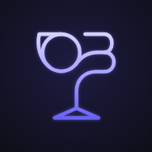
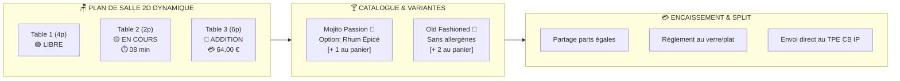
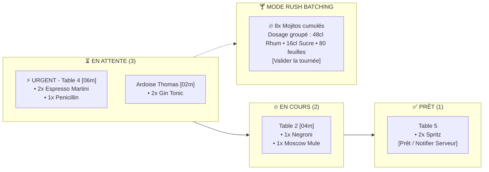
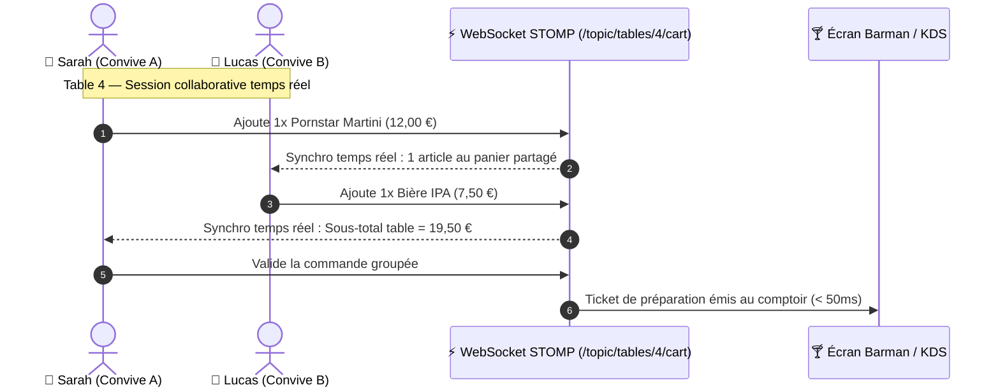
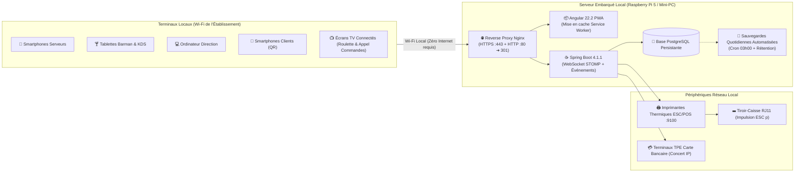

<p align="center">
  
</p>

<h1 align="center">OpenBar</h1>

<p align="center">
  <strong>L'OS de caisse et de gestion nouvelle génération pour bars, brasseries et établissements de nuit : ultra-rapide, 0% de commission, liberté totale d'hébergement (sur votre matériel existant ou dans notre Cloud souverain français), résilience 100% hors-ligne et innovations mixologiques exclusives.</strong>
</p>

<p align="center">
  <a href="https://github.com/FunWarry/Open-Bar/actions/workflows/ci.yml"></a>
  <a href="https://sonarcloud.io/summary/new_code?id=FunWarry_Open-Bar"></a>
  <a href="https://sonarcloud.io/summary/new_code?id=FunWarry_Open-Bar"></a>
  <a href="https://github.com/FunWarry/Open-Bar/releases"></a>
  <a href="https://openjdk.org/projects/jdk/22/"></a>
  <a href="https://spring.io/projects/spring-boot"></a>
  <a href="https://angular.dev"></a>
  <a href="https://ionicframework.com"></a>
  <a href="https://jsverse.github.io/transloco/"></a>
  <a href="#-licence--conditions-dexploitation"></a>
  <a href="#-arguments-de-vente--pourquoi-openbar-"></a>
  <a href="#-architecture--r%C3%A9silience-locale"></a>
</p>

<p align="center">
  <a href="#-pourquoi-openbar--les-arguments-de-vente"><strong>Arguments de Vente</strong></a> •
  <a href="#-pourquoi-nous-choisir--comparatif-avec-les-principaux-concurrents"><strong>Comparatif Concurrence</strong></a> •
  <a href="#-le-socle-indispensable-fonctionnalit%C3%A9s-de-base"><strong>Fonctionnalités de Base</strong></a> •
  <a href="#-les-innovations-exclusives-openbar"><strong>Innovations Exclusives</strong></a> •
  <a href="#-modules-m%C3%A9tier-plug-and-play"><strong>Modules Plug & Play</strong></a> •
  <a href="#-aper%C3%A7u-des-interfaces"><strong>Showcase UI</strong></a> •
  <a href="#-architecture--r%C3%A9silience-locale"><strong>Architecture</strong></a> •
  <a href="#-d%C3%A9marrage-rapide-en-60-secondes"><strong>Quickstart</strong></a> •
  <a href="docs/TECHNICAL_GUIDE.md"><strong>Guide Technique 📖</strong></a>
</p>

---

## 💡 Pourquoi OpenBar ? (Les Arguments de Vente)

Gérer un bar ou un restaurant en plein rush ne devrait pas être une source constante de stress technique, de pannes réseau ou de surfacturations dissimulées. 

La plupart des solutions de caisse actuelles (Lightspeed, Toast, Zelty, Popina, SumUp) imposent des contraintes lourdes aux exploitants : commissions prélevées sur chaque transaction CB, dépendance fatale à Internet qui bloque l'établissement dès que la box plante, et obligation d'acheter du matériel propriétaire hors de prix.

**OpenBar a été pensé pour inverser le rapport de force et redonner le contrôle total aux professionnels.**

### 1. 💰 0% de Commission sur votre Chiffre d'Affaires
Contrairement aux terminaux et caisses qui prélèvent discrètement 1,5% à 3% sur chacun de vos paiements par carte, **OpenBar ne prend aucun centime sur vos encaissements**. Vous payez un abonnement mensuel transparent et prévisible, quel que soit votre volume de ventes. Vos marges restent dans votre poche.

### 2. 📱 Bring Your Own Hardware (BYOH) — Zéro Matériel Imposé
**Nous ne vous vendons AUCUN matériel propriétaire.** Vous n'avez pas besoin de souscrire à des locations de tablettes fermées à 150 €/mois :
- OpenBar tourne comme une **Progressive Web App (PWA)** fluide sur les équipements déjà en votre possession : smartphones des serveurs, tablettes Android ou iPad grand public, PC de caisse.
- Le serveur local s'installe sur n'importe quel ordinateur existant ou sur un simple **Raspberry Pi 5** (consommation électrique minime de ~5W).
- Vous êtes 100% propriétaire et libre de votre parc informatique.

### 3. 🛡️ Résilience 100% Hors-Ligne (Zéro Panne Internet)
Un samedi soir à 22h, la connexion Internet du quartier est coupée ? **Votre établissement ne s'arrête pas une seule seconde.**
- OpenBar opère intégralement sur votre réseau Wi-Fi local.
- Les commandes envoyées depuis la terrasse s'affichent instantanément (< 50ms) sur le Kanban du barman et l'écran cuisine KDS.
- Les tickets de commande s'impriment et les terminaux bancaires (TPE) continuent d'encaisser sans aucune connexion au cloud public.

### 4. 🇫🇷 Liberté d'Hébergement : Sur votre Matériel ou dans notre Cloud Français
- **Hébergement Maison (On-Premise)** : Autonomie souveraine maximale au sein de votre établissement avec tolérance de 2 jours hors-ligne pour la validation de licence.
- **Hébergement Cloud Souverain (France)** : Formule clé en main infogérée sur nos clusters Kubernetes hébergés en France (Scaleway / OVHcloud), avec une stricte étanchéité des données par établissement (**Database-per-Tenant**).

### 5. 🔒 Conformité Fiscale Rigoureuse (NF525 / CGI art. 286)
- Clôture Z de caisse journalière inaltérable scellée cryptographiquement en SHA-256.
- Journal d'audit continu des opérations de caisse.
- Export du **Fichier des Écritures Comptables (FEC)** en 1 clic pour votre expert-comptable.
- Modules de réconciliation des pertes, casse et consommations du personnel 100% conformes à la loi anti-fraude.

---

## 🥊 Pourquoi nous choisir ? (Comparatif avec les principaux concurrents)

Le marché des caisses et logiciels de bar est dominé par des acteurs historiques ou des géants du SaaS qui ont bâti leur modèle sur l'enfermement propriétaire et les frais cachés.

Voici comment **OpenBar** se positionne face aux leaders du marché en France et à l'international :

| Critère & Capacité Clé | 🍹 OpenBar | 🍏 Popina | 🍏 L'Addition | 🍔 Zelty | 🇺🇸 Lightspeed / Toast | 💳 SumUp / Tiller |
| :--- | :---: | :---: | :---: | :---: | :---: | :---: |
| **Commission sur encaissements CB** | **0% (Zéro)** | 1,2% à 1,5% | 0% (si contrat TPE) | 1,4% à 2,0% | 1,4% à 2,9% + fixe | 1,25% à 1,75% |
| **Matériel imposé (Vendor Lock-in)** | **Zéro (BYOH)**<br>Android, iOS, PC, Pi 5 | ❌ iPad Apple obligatoire | ❌ Pack Apple (iPads + Mac mini ~3000€) | ❌ iPad / Écrans Elo propriétaires | ❌ Terminaux fermés ($400-$1200) | ❌ iPad Apple obligatoire |
| **Résilience 100% Hors-Ligne (Coupure Internet)** | **✅ Autonome à 100%**<br>(Wi-Fi local sub-50ms) | ❌ Bloqué ou très dégradé | ⚠️ Local complexe (Airport/Mac) | ❌ Bloqué net sans 4G/Fibre | ⚠️ Mode dégradé risqué (buffer) | ❌ Bloqué net sans 4G/Fibre |
| **Liberté d'Hébergement des Données** | **Maison (BYOH)** ou **Cloud France (K8s)** | ❌ Cloud US/Propriétaire | ⚠️ Mac mini sur place | ❌ Cloud propriétaire | ❌ Cloud US multi-tenant | ❌ Cloud propriétaire |
| **Mode Rush Batching Barman** | **✅ Inclus nativement**<br>(Cumul auto des tournées) | ❌ Inexistant | ❌ Inexistant | ❌ Inexistant | ❌ Inexistant | ❌ Inexistant |
| **Génie Mixologique & Roue des Saveurs** | **✅ Fiches cl/gouttes**<br>+ Roue des accords IBA | ❌ Simple SKU avec prix | ❌ Simple SKU avec prix | ❌ Axé cuisine burger/pizza | ❌ Simple SKU avec prix | ❌ Simple SKU avec prix |
| **Animation Gamifiée (Roulette TV)** | **✅ Inclus nativement**<br>(Écran TV déporté) | ❌ Inexistant | ❌ Inexistant | ❌ Inexistant | ❌ Inexistant | ❌ Inexistant |
| **Jaugeage Visuel & Inventaire Bouteilles** | **✅ Jauge tactile**<br>(10% à 90% par zone) | ⚠️ Déstockage basique | ⚠️ Déstockage basique | ⚠️ Module payant (+49€/m) | ⚠️ Module payant cher | ❌ Très basique |
| **Liaison Directe TPE Bancaire (IP)** | **✅ Protocole Concert IP**<br>(Zéro ressaisie) | ⚠️ Passerelle payante | ✅ TPE bancaire classique | ⚠️ Middleware payant | ❌ Réseau fermé | ⚠️ Lecteur Bluetooth lent |
| **Commande Client QR Code & Panier Partagé** | **✅ Inclus nativement**<br>(Zéro app à installer) | ⚠️ Option payante | ❌ Inexistant | ⚠️ Option payante (+39€/m) | ⚠️ Option payante ($) | ❌ Inexistant |
| **Conformité Fiscale NF525 & Export FEC** | **✅ Scellement SHA-256**<br>+ FEC en 1 clic | ✅ Conforme | ✅ Conforme | ✅ Conforme | ⚠️ US / Partiel | ✅ Conforme |

---

### 🔍 En quoi OpenBar fait la différence au quotidien ?

#### 1. Face à Popina & L'Addition : Fini le « racket » Apple et les devis à 4 000 €
Popina et L'Addition vous enferment dans l'écosystème Apple : vous êtes contraint d'acheter des iPads récents, des bornes Wi-Fi propriétaires et parfois un Mac mini dédié, pour une facture matérielle initiale dépassant les 3 000 € à 5 000 €. 
- **Avec OpenBar** : Utilisez **n'importe quel smartphone, tablette ou PC** déjà présent dans votre établissement. Un simple boîtier à 80 € (Raspberry Pi 5) ou un PC de bureau existant suffit pour faire tourner tout le bar.

#### 2. Face à Zelty : Un outil pensé pour l'artisanat du cocktail, pas pour les chaînes de fast-food
Zelty est taillé pour les franchises de burgers et la restauration rapide avec des dizaines de modules payants à empiler (KDS +29 €/mois, Click & Collect +39 €/mois, Stocks +49 €/mois), portant la facture à plus de 250 € par mois et par point de vente.
- **Avec OpenBar** : Notre système a été conçu au comptoir pour les débits de boissons, pubs et bars à cocktails. Le KDS, les ardoises au comptoir, la roue des accords gustatifs et les variations de recettes sont incluses sans surcoût.

#### 3. Face à Lightspeed & Toast : Zéro commission sur votre chiffre d'affaires
Les géants américains comme Toast ou Lightspeed imposent leurs propres passerelles de paiement ou appliquent des pénalités financières exorbitantes si vous utilisez vos propres terminaux bancaires. Sur une saison à 200 000 € de chiffre d'affaires, une commission de 2% représente **4 000 € prélevés directement sur votre bénéfice net**.
- **Avec OpenBar** : **0% de commission**. Nous raccordons directement vos TPE bancaires professionnels de votre banque via le protocole réseau IP Concert. Vous gardez 100% de votre marge.

#### 4. Face à SumUp / Tiller : Une vraie bête de course taillée pour le coup de feu
SumUp propose des solutions d'entrée de gamme adaptées aux petits commerces de détail, mais montrant rapidement leurs limites le vendredi soir : lecteurs Bluetooth qui se déconnectent, latence de validation, absence de plan de salle dynamique digne de ce nom et impossibilité de gérer des tournées groupées.
- **Avec OpenBar** : La communication locale par WebSocket STOMP garantit une **latence inférieure à 50ms**. Le mode Rush Batching agrège vos tournées de verres pour que vos barmans ne perdent pas une seconde.

---

## ⚡ Le Socle Indispensable (Fonctionnalités de Base)

OpenBar regroupe nativement toutes les fonctions vitales nécessaires à l'exploitation quotidienne d'un établissement de débit de boissons et restauration :

```
┌────────────────────────────────────────────────────────────────────────────────────────┐
│                              LE SOCLE OPÉRATIONNEL OPENBAR                             │
├──────────────────────────┬─────────────────────────────┬───────────────────────────────┤
│ 📱 SALLE & PRISE DE CMDE │ 🍸 COMPTOIR & PRESTATION    │ 💳 ENCAISSEMENT & PILOTAGE   │
│ • Plan de salle 2D       │ • Kanban STOMP < 50ms       │ • Liaison TPE IP (Concert)    │
│ • Filtres saveurs/allers │ • Écran KDS Cuisine         │ • Split d'addition chirurgical│
│ • Ardoises clients (Tabs)│ • Impression ESC/POS :9100  │ • Clôtures de caisse X et Z   │
│ • QR Code table invité   │ • Déstockage au centilitre  │ • Export FEC comptabilité     │
└──────────────────────────┴─────────────────────────────┴───────────────────────────────┘
```

- **Plan de Salle 2D Vectoriel & Magnétique (Konva.js)** : Visualisation interactive en temps réel de votre salle et terrasse (grille au centimètre 1px = 1cm). Statuts visuels instantanés (table libre, commande en cours, servie, addition demandée).
- **Prise de Commande Tactile Ultra-Rapide** : Optimisée pour smartphones serveurs d'une seule main. Recherche instantanée, filtrage par catégories, sélection d'arômes dominants (Acidulé 🍋, Fruité 🍓, Fumé 💨, etc.) et exclusion directe des allergènes.
- **Ardoises & Comptes Clients au Comptoir (Bar Tabs)** : Ouvrez et suivez les consommations des clients accoudés au bar sans devoir leur assigner de table physique, avec transfert possible vers une table à tout moment.
- **Split d'Addition Ultra-Flexible** : Division d'addition à parts égales, par convive, au prorata ou sélection au verre/plat. Zéro calcul mental pour le personnel.
- **Liaison Directe TPE Bancaire (Protocole CB Concert sur IP)** : Le montant de l'addition est automatiquement poussé sur le terminal bancaire via le réseau local. Finies les erreurs de frappe manuelle du montant sur le TPE.
- **Impression Thermique Réseau Directe (ESC/POS)** : Envoi direct des bons de préparation au comptoir et en cuisine sur port réseau `:9100`, avec déclenchement automatique du tiroir-caisse RJ11.
- **Carte Digitale & Commande Client par QR Code** : Les clients scannent le QR code de leur table pour consulter la carte interactive, composer un panier partagé synchronisé en temps réel et appeler un serveur sans installer d'application mobile.
- **Gestion des Équipes & Sécurité des Rôles** : Rôles strictement cloisonnés (Admin, Manager, Serveur, Barman), sessions sécurisées par jetons JWT, historique d'activité et plannings de shifts.

---

## 🌟 Les Innovations Exclusives OpenBar

Au-delà de la caisse classique, OpenBar intègre des technologies d'avant-garde spécifiquement pensées pour l'univers du bar, des cocktails et de la vie nocturne :

```mermaid
flowchart TD
    subgraph Innovations ["🚀 INNOVATIONS EXCLUSIVES OPENBAR"]
        direction TB
        I1["🍸 Mode Rush Batching (Regroupement instantané des tournées)"]
        I2["🎨 Roue des Accords de Saveurs & Sunburst Mixologique"]
        I3["🎲 Roulette Cocktail Mystère & Écran TV Déporté"]
        I4["📺 Écran d'Appel des Commandes Prêtes TV (/order-display)"]
        I5["💰 Calculateur de Rentabilité & P&L au Centilitre (Matière + Main-d'œuvre)"]
        I6["📱 Scan & Reconnaissance Code-Barres Bouteilles (Open Food Facts)"]
        I7["🏷️ Traçabilité DLC/DLUO & Hygiène HACCP (façon ePackPro)"]
        I8["🤖 Assistant IA Mixologue & Sourcing Fournisseurs (via MCP)"]
        I9["🌦️ Prévisions Prédictives par Micro-Saisonnalité (Météo & Événements)"]
        I10["🍷 Jaugeage Visuel de Bouteille & Inventaire par Glissement de Doigt"]
    end
```



### 🍸 1. Le Mode Rush Batching Barman
En plein pic d'affluence, préparer les cocktails un par un fait perdre un temps précieux.
- OpenBar analyse en temps réel toutes les commandes en attente et **agrège automatiquement les cocktails identiques**.
- Si 4 tables commandent au total 8 Mojitos, l'écran du barman affiche immédiatement la fiche de batching groupée : `36cl Rhum • 12cl Sirop de sucre • 48cl Eau gazeuse • 80 feuilles de menthe`.
- Les barmans envoient les tournées jusqu'à **3 fois plus vite**, sans jamais se tromper dans les proportions.

### 🎨 2. Roue des Accords de Saveurs & Sunburst Mixologique
- **Roue chromatique et Sunburst interactif** : Explorez l'harmonie des arômes entre spiritueux, jus, sirops maison et bitters (Acidulé, Fruité, Fumé, Amer, Épicé, Herbacé, Gourmand).
- **Variantes de recettes intelligentes** : Déclinaisons en un clic (version mocktail sans alcool, substitution par un spiritueux d'exception ou variante épicée) avec réajustement instantané des fiches techniques et du prix de vente.
- **Bibliothèque IBA & Craft intégrée** : Plus de 80 recettes officielles prêtes à l'emploi avec fiches pas-à-pas et visuels.

### 🎲 3. Animation Gamifiée : Roulette Cocktail Mystère & Écran TV Déporté
- **Une expérience client mémorable** : Les clients indécis font tourner une roulette de casino animée depuis leur smartphone ou la tablette du comptoir (sons de roue, suspense et pluie de confettis).
- **Affichage synchronisé sur grand écran TV (`/roulette-display`)** : Diffusez les tirages en direct dans votre salle via un simple navigateur sur votre télévision ou vidéoprojecteur.
- **Déstockage intelligent** : Orientez l'algorithme de tirage vers vos cocktails à plus forte marge ou vers les ingrédients en surstock que vous souhaitez écouler en priorité.

### 📺 4. Écran d'Appel des Commandes Prêtes (`/order-display`)
- Affichage dynamique sur écran TV au-dessus du bar indiquant les numéros de commande prêts à être retirés et ceux en cours de préparation.
- Réduit la cohue et les files d'attente au comptoir lors des soirées chargées.

### 💰 5. Calculateur de P&L & Rentabilité Chirurgicale
- Ne pilotez plus vos tarifs au doigt mouillé : OpenBar calcule votre **marge brute et nette réelle au centilitre** pour chaque recette.
- Prise en compte du coût d'achat réel des bouteilles et conditionnements (recalcul automatique du **Prix Moyen Pondéré PAMP/WAC** lors de chaque réception de livraison).
- Intégration du **coût horaire de main-d'œuvre** (temps de préparation du cocktail par le barman) et des charges pour connaître votre véritable rentabilité nette par verre.

### 📱 6. Reconnaissance des Bouteilles par Code-Barres
- Scannez le code-barres EAN d'une nouvelle bouteille avec l'appareil photo d'un smartphone pour l'enregistrer instantanément.
- Connexion directe à la base publique **Open Food Facts** pour pré-remplir les données (dénomination, degré alcoolique, allergènes, fabricant) sans saisie fastidieuse.

### 🏷️ 7. Traçabilité Hygiène & DLC/DLUO (Style ePackPro)
- Gestion complète de la réception des marchandises périssables (fruits frais, jus pressés, crèmes, sirops maison).
- Suivi rigoureux des dates limites de consommation (DLC/DLUO) avec alertes visuelles avant péremption pour éliminer le gaspillage.
- Checklists opérationnelles récurrentes dématérialisées : procédures d'ouverture, contrôle des températures de frigo et routines de nettoyage de fermeture.

### 🤖 8. Assistant IA Mixologue & Sourcing Fournisseurs (via MCP)
- Générateur intelligent de recettes de cocktails éphémères adaptées aux fonds de bouteilles et stocks dormants de votre cave.
- Recherche automatique des ingrédients manquants et comparaison auprès de vos catalogues fournisseurs via connecteurs MCP.

### 🌦️ 9. Prédictions par Micro-Saisonnalité
- Moteur prédictif anticipant vos volumes de vente en croisant la **météo locale en temps réel**, l'historique d'affluence, le calendrier des jours fériés et les événements majeurs (matchs de football, concerts locaux).
- Vous prévient en amont pour ajuster vos commandes fournisseurs et vos plannings d'équipe.

### 🍷 10. Jaugeage Visuel de Bouteille & Inventaires Tactiles
- Finie la pesée fastidieuse au gramme près de chaque bouteille : réglez la jauge visuelle du niveau restant en un glissement de doigt sur tablette (de 10% en 10%).
- Gestion multi-emplacements (Bar principal, Réserve, Speed rail, Terrasse).
- Régularisation automatique des écarts théoriques vs constatés et génération de fiches d'inventaire certifiées au format PDF et CSV.

---

## 🧩 Modules Métier Plug-and-Play

OpenBar est conçu selon une architecture **modulaire à la carte** : activez ou désactivez les fonctionnalités en 1 clic selon votre profil d'établissement pour garder une interface épurée et adaptée.

| Module | Fonction principale | Idéal pour |
|:---|:---|:---:|
| 🍳 **Cuisine & KDS** | Écran tactile dédié cuisine (`/kitchen`) et routage automatique des plats chauds et tapas | Bar à tapas, Restaurant, Food-truck |
| 🎉 **Happy Hour** | Moteur de remises horaires automatiques (en % ou prix fixe) qui bascule selon vos tranches | Bar à bières, Pub, Bar festif |
| 👥 **Équipe & Shifts** | Plannings hebdomadaires, suivi des présences et replay d'audit des actions | Tout établissement avec équipe |
| 🪑 **Plan de Salle** | Plan 2D vectoriel Konva.js avec grille magnétique au centimètre et statut des tables | Bar à cocktails, Brasserie, Restaurant |
| 📲 **Commande QR** | Carte smartphone client, panier collaboratif multi-convives et appel serveur | Terrasse, Salle spacieuse, Grand volume |
| 📦 **Gestion Stocks** | Déstockage automatique au centilitre, alertes de réapprovisionnement et pertes | Tout débit de boissons |
| 🧾 **Ardoises Clients (Tabs)** | Comptes ouverts au comptoir sans table obligatoire, règlements différés | Bar de quartier, Pub, Club |
| 📚 **Bibliothèque Cocktails** | Fiches techniques complètes de 80+ recettes officielles IBA et créations maison | Cocktail bar, Speakeasy, Lounge |
| 📋 **Inventaire Physique** | Sessions de comptage multi-zones, jaugeage visuel et réconciliation des écarts | Tout établissement gérant une cave |
| 🎲 **Roulette Mystère** | Roulette gamifiée sur mobile et écran TV déporté (`/roulette-display`) | Bar festif, Pub étudiant, Soirées à thème |

---

## 🖥️ Aperçu des Interfaces

### 📱 1. La Vue Serveur : Ergonomie & Prise de Commande Tactile
*Conçue pour smartphone et tablette, utilisable d'une seule main en salle ou en terrasse.*



---

### 🍸 2. Le Dashboard Barman & KDS Cuisine
*Pour les écrans tactiles au comptoir : visibilité instantanée, fiches recettes et mode rush.*



---

### 📲 3. La Commande Client par QR Code (Zéro Téléchargement)
*Le client scanne le QR code placé sur la table : la carte s'ouvre instantanément dans son navigateur.*



---

## 🏗️ Architecture & Résilience Locale

OpenBar est spécialement conçu pour opérer dans un **réseau local sécurisé et autonome** :



---

## 🚀 Démarrage Rapide en 60 Secondes

### Prérequis
- [Docker & Docker Compose](https://docs.docker.com/get-docker/) installés sur votre machine ou serveur local.

### 1. Cloner le projet et lancer la stack
```bash
git clone https://github.com/FunWarry/Open-Bar.git
cd Open-Bar

# Lancer la stack complète (PostgreSQL, Spring Boot, Nginx TLS, Sauvegardes)
docker compose -f docker-compose.prod.yml up -d
```

### 2. Accéder à l'application
Ouvrez votre navigateur sur : **`https://localhost`** (ou l'adresse IP locale de votre machine).

### 3. Comptes de démonstration prêts à l'emploi

| Rôle | Email de Connexion | Mot de Passe | Interface & Droits |
|------|---------------------|--------------|-------------------|
| **Admin** | `admin@openbar.lan` | `admin123` | Configuration globale, TPE, Modules & Licences (`/admin/settings`) |
| **Manager** | `manager@openbar.lan` | `manager123` | Cockpit KPIs, Achats, Stocks, P&L & Clôtures Z (`/dashboard-manager`) |
| **Serveur** | `serveur@openbar.lan` | `serveur123` | Plan de salle 2D, Ardoises & Prise de commandes (`/serveur`) |
| **Barman** | `barman@openbar.lan` | `barman123` | Kanban de préparation, Recettes & Mode Rush (`/barman`) |

> 📖 **Pour le développement pas-à-pas** (Maven, Angular CLI, Swagger UI), consultez le **[Guide Technique](docs/TECHNICAL_GUIDE.md#4-guide-de-démarrage-rapide-quickstart)**.

---

## 🛡️ Qualité & Rigueur d'Ingénierie

OpenBar est développé selon les standards les plus exigeants de l'ingénierie logicielle professionnelle :
- **Documentation 100% en Anglais** : JavaDoc sur tous les services et DTOs backend, TSDoc sur tous les composants Angular, spécifications OpenAPI 3.1 sur tous les contrôleurs REST.
- **Zéro Problème IDE & Zéro `@SuppressWarnings`** : Aucune alerte ignorée, vérification statique stricte TypeScript et compilation Java sans compromis.
- **Parité i18n Transloco Stricte** : 100% des textes traduisibles avec parité stricte entre `fr.json` et `en.json`.
- **Pyramide de Tests Complète** :
  - **3 000+ tests unitaires Frontend (Karma / Jasmine)** avec typage strict (zéro `any`).
  - **1 000+ tests unitaires & intégration Backend (JUnit 5 + Testcontainers PostgreSQL)**.
  - **103 scénarios End-to-End sous Playwright** validant les parcours utilisateurs réels.
- **SonarCloud Grade A** : Couverture sur nouveau code supérieure à 80%, zéro vulnérabilité, zéro code smell de sécurité.

---

## ⚖️ Licence & Modèle Commercial

OpenBar est un logiciel commercial privé et propriétaire, protégé par le droit d'auteur et distribué sous [**Licence Propriétaire OpenBar**](LICENSE.md).  
Pour le détail des obligations, mentions légales et gouvernance des données, consultez nos [**Conditions Générales d'Utilisation & de Vente (CGU/CGV)**](TERMS_OF_SERVICE.md).

### 💳 Modèle d'Abonnement Mensuel
- **Facturation par Établissement** : Un abonnement mensuel fixe et transparent, sans pourcentage prélevé sur vos recettes.
- **Politique Matérielle (Bring Your Own Hardware — Aucun matériel vendu)** : OpenBar ne vend, ne loue et ne fournit **aucun matériel physique**. Vous restez libre de votre équipement (PC, tablettes, smartphones, Raspberry Pi 5).
- **Hébergement au Choix** : Fonctionnement autonome On-Premise dans votre établissement ou hébergement managé sur notre Cloud souverain en France (Scaleway / OVHcloud).

### 💼 Souscrire un Abonnement ou Demander un Déploiement
Pour activer une licence, demander une démonstration ou échanger sur vos besoins :
- **Auteur & Fondateur** : Mathéo Gevraise ([@FunWarry](https://github.com/FunWarry))
- **Dépôt & Administration Privée** : [https://github.com/FunWarry/Open-Bar](https://github.com/FunWarry/Open-Bar)
- **Kanban & Roadmap en Direct** : [GitHub Projects OpenBar](https://github.com/users/FunWarry/projects/3/views/1)

---

<p align="center">
  <strong>OpenBar</strong> — Libérez vos équipes, sublimez vos cocktails et régalez vos clients. 🍸🚀
</p>
